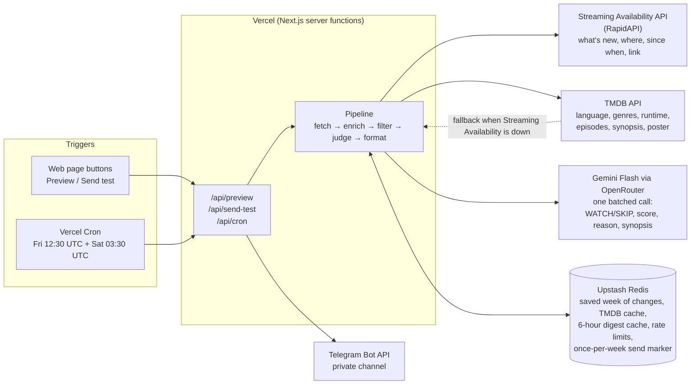

# 📡 OTT Release Radar

A weekly Telegram digest for **Naman**: the movies and TV shows that became available **in the last 7 days** on **Netflix, Prime Video or JioHotstar in India**, filtered to his taste, each with a Gemini Flash **WATCH / SKIP** verdict. Posted every Friday evening to a private Telegram channel, with a public web page for testing.

| | |
|---|---|
| **Live site** | **https://ott-release-radar-iota.vercel.app** |
| **Code** | https://github.com/sushmithasarlana-bit/ott-release-radar |
| **Schedule** | Every Friday ~18:00 IST (Vercel cron `30 12 * * 5`), with a Saturday backup run |
| **AI** | Google Gemini Flash only, called through [OpenRouter](https://openrouter.ai) (`google/gemini-3.7-flash`, backup `google/gemini-3.5-flash`). No Claude/Anthropic API anywhere. |

---

## How to test (for the professor)

No account, keys or setup needed. Everything below works from any browser, including a private window.

1. **Open https://ott-release-radar-iota.vercel.app.**
   The last run loads instantly: this week's top pick, the counts (new → matching → worth watching) and poster cards for every matching title.

2. **Click “Preview this week’s digest”.**
   This runs the full live pipeline on the server: Streaming Availability → TMDB → filters → Gemini.
   - If the last run is less than 6 hours old, it is reused (this protects the free API limits) and the page says **“Last refreshed at …”**.
   - Otherwise a fresh run takes about **30–45 seconds**, and the page shows which step it is on.
   - **Nothing is sent** to Telegram.

3. **Explore the results.**
   - Filter by **platform**, **✓ Watch / ✕ Skip**, **genre** and **language**.
   - Each card shows:
     - platform badges and the WATCH/SKIP score,
     - runtime or season and episode count,
     - language, year and genres,
     - the **verified “On ⟨platform⟩ since ⟨date⟩”**,
     - a 2-line synopsis and Gemini’s reason,
     - a link to the title on the platform.

4. **Build a Watch Next list.**
   - Tap the **♥** on any poster. The heart pops, confetti bursts, and the **Watch Next** box in the top-right corner glows and counts up.
   - Open the box, then pick one **🎬 Final watch** and one **⏭ Next watch** from your shortlist.
   - You can swap the picks, clear them, remove titles, or clear the whole list.
   - The list is saved in your browser, so it survives reloads and next week’s refresh.

5. **Click “Send test digest to Telegram”** and enter the **demo password** (shared with you separately).
   The digest is posted to the Telegram channel with a **“[TEST]”** header. Test sends never count as the Friday digest.

6. **Scroll to “Behind the scenes”.** It shows:
   - the last run’s count at every filter step,
   - which data source was used and whether each API worked,
   - RapidAPI requests left this month and the time each step took,
   - any fallbacks, the next scheduled run and the last Friday send,
   - Naman’s preferences and a short “How this works”.

**Limits on the buttons:**
- **Preview:** 10 per 10 minutes per connection.
- **Test send:** 5 attempts per hour per connection, and 20 per day overall.

The Friday endpoint (`/api/cron`) only runs with the secret Vercel sends. Opening it in a browser returns `401 Unauthorized`, which is intended.

---

## What counts as “new”

> The date a title **became available on Netflix, Prime Video or JioHotstar in India** within the last 7 days, as reported by the Streaming Availability API.
> It is **not** the theatrical or global release date. An old film newly added to Prime Video counts; a new film that is not on these platforms in India does not.

- **New seasons** of existing series count, and get a **📺 New Season** badge.
- Only titles **included in the subscription** count. Prime Video rentals and paid add-on channels (e.g. Lionsgate Play via Prime) are excluded.
- **Bulk re-listings.** In October 2026, JioHotstar re-listed thousands of old titles as “new” in one or two days. On any day a platform adds **150+** titles, only titles from this year or last year count from that day; the rest are left out and counted on the page.

---

## Architecture



| Component | Job | Code |
|---|---|---|
| **Streaming Availability** (RapidAPI) | What became available, on which platform, since when, and the deep link | `src/lib/sources/streamingAvailability.ts`, `src/lib/changeLog.ts` |
| **TMDB** | What the title is: original language, genres, runtime, episodes, synopsis, poster | `src/lib/sources/tmdb.ts`, `src/lib/enrich.ts` |
| **Gemini Flash** (via OpenRouter) | One batched call per run → JSON verdicts, validated | `src/lib/sources/gemini.ts` |
| **Upstash Redis** | Shared state between serverless runs | `src/lib/store.ts`, `src/lib/service.ts` |
| **Telegram** | Delivery (HTML, link previews off, split under 4,096 chars) | `src/lib/sources/telegram.ts`, `src/lib/digest.ts` |
| **Pipeline** | Ties it together and records counts, sources, notes and timings | `src/lib/pipeline.ts` |
| **Web page** | Test page (server-rendered shell + interactive client) | `src/app/` |
| **Watch Next** | Per-browser shortlist with Final / Next picks, saved in `localStorage` | `src/app/WatchNext.tsx`, `src/app/watchNextStore.ts` |

### The pipeline, step by step

1. **Fetch what’s new (Streaming Availability).**
   - Calls `GET /changes` with `country=in`, `change_type=new` and `from` = 7 days ago, newest first, twice: `item_type=show` for new titles and `item_type=season` for new seasons.
   - Catalogs are `netflix.subscription`, `prime.subscription` and `hotstar.subscription`. These service IDs were confirmed with `GET /countries/in`, not assumed.
   - Pages follow `hasMore` / `nextCursor`. Netflix + Prime and JioHotstar are fetched separately, so a flood on one platform can’t crowd out the others.
   - Fetched changes are **saved** in Redis, so each refresh only asks for what changed since last time: about 4 requests instead of re-downloading the week.
2. **Group.** One entry per title, with all its platforms. Seasons added in bulk (e.g. Seasons 4–14 at once) become one entry.
   - **Links:** the change’s own deep link, else the show’s link for that platform, else the TMDB page. Links are never guessed.
3. **Enrich (TMDB).** `GET /movie/{id}` or `/tv/{id}` using the `tmdbId` from Streaming Availability. Results are cached for 7 days. If TMDB fails for a title, Streaming Availability’s own genres, overview, runtime and episode count are used instead.
4. **Filter, in our own code.**
   - **Strict:** platform, 7-day window, original language `hi` / `en` / `ta`.
   - **Loose genre:** Thriller, Crime, Mystery, Science Fiction / Sci-Fi & Fantasy, Drama. TMDB’s TV genres have no “Thriller”, so Crime and Mystery stand in for it.
5. **Judge (Gemini Flash, via OpenRouter).**
   - **One call** with Naman’s preferences and every title’s details.
   - **Settings:** temperature 0.2, a strict JSON schema, and checks in code (WATCH = 6–10, SKIP = 1–5).
   - **Synopsis:** written only from TMDB’s text; “Synopsis unavailable” is decided by our code, not the model.
   - **If Gemini fails:** the backup Flash model is tried, then every title shows “AI verdict unavailable”.
6. **Format and deliver.**
   - **Header:** “🆕 NEW THIS WEEK” plus the date range.
   - **Order:** WATCH titles first, in full, highest score first; SKIP titles as one line each.
   - **Escaping:** HTML special characters in titles are escaped.
   - **Splitting:** only between titles when over Telegram’s limit.
   - **Quiet week:** a short message with how many titles were checked, instead of nothing.

Every run records the count at each step (e.g. *296 changes → 91 new titles → 67 in language → 58 after genre → 31 WATCH*), the data source used and any fallbacks. These are shown on the page.

### Reliability

| Situation | What happens |
|---|---|
| Streaming Availability down / out of quota | Uses the saved week if it is under 24 h old; otherwise falls back to **TMDB discover** (`watch_region=IN` + provider IDs 8 / 119 / 2336) and labels the digest **“Limited data this week”** |
| RapidAPI returns 429 “Too many requests” | Requests run one at a time, with retries (1.5 s, 3 s, 6 s) |
| Fewer than 100 RapidAPI requests left this month | Test-page runs reuse saved data; the Friday digest keeps the rest |
| TMDB fails for a title | Retried 3 times, then Streaming Availability’s details are used |
| Gemini fails or returns bad JSON | Backup Flash model, then “AI verdict unavailable” (the digest still goes out) |
| Nothing matches | “😴 Quiet week” message with the number of titles checked |
| Two clicks at once | A lock lets only one pipeline run; the other waits and shares the result |
| Cron delivered twice / Friday run missed | A per-week marker (Redis `SET NX`) allows exactly one send per Friday-to-Thursday week; the Saturday backup only sends if Friday didn’t |
| Telegram send fails | The weekly marker is released so the backup or a retry can send |

---

## Security

- **All API calls happen on the server.** The browser only talks to `/api/preview` and `/api/send-test`, and never receives a key. This was verified by scanning the page and every script it downloads.
- **Keys live only in `.env.local`** (ignored by git) **and in Vercel environment variables**, stored as *Sensitive*. `scripts/check-secrets.mjs` checks that no key value appears in any file before each push.
- **`/api/cron` requires `Authorization: Bearer <CRON_SECRET>`.** Vercel sends this automatically.
- **The test send requires `DEMO_PASSWORD`**, compared in constant time, and is rate-limited per connection and per day.
- **Error messages on the page say which API failed in plain words.** They never include raw errors, URLs or keys.

---

## Configuration

Naman’s preferences live in **`config/preferences.json`**:

```json
{
  "viewerName": "Naman",
  "region": "IN",
  "platforms": ["Netflix", "Prime Video", "JioHotstar"],
  "languages": ["hi", "en", "ta"],
  "genres": ["thriller", "sci-fi", "indie drama"],
  "lookbackDays": 7
}
```

**Adding a genre.** Add a word to `"genres"`. The filter, the page’s genre chips and Gemini’s instructions all update.
- **Words understood:** thriller, crime, mystery, suspense, sci-fi, science fiction, fantasy, drama, horror, comedy, action, adventure, romance, animation, anime, documentary, family, kids, history, war, politics, music, western, reality.
- **Phrases work:** “indie drama” matches *drama*.
- **Typos are flagged:** unrecognised words are shown on the page.
- **Cache:** changing preferences makes the next run ignore the old cached result.

---

## Run it locally

Requirements: Node.js 20.9+ (developed on Node 24).

```bash
npm install
cp .env.example .env.local   # then fill in the values
npm run dev                  # http://localhost:3000
```

| Variable | What it is |
|---|---|
| `TELEGRAM_BOT_TOKEN` | Bot token from @BotFather (the bot must be an admin of the channel) |
| `TELEGRAM_CHAT_ID` | Channel ID (`-100…`) |
| `TMDB_TOKEN` | TMDB **API Read Access Token** |
| `RAPIDAPI_KEY` | RapidAPI key subscribed to *Streaming Availability* |
| `OPENROUTER_API_KEY` | OpenRouter key (openrouter.ai → Keys); used only to call Google Gemini Flash models |
| `CRON_SECRET` | Random string (32+ characters) protecting `/api/cron` |
| `DEMO_PASSWORD` | Password for the test-send button |
| `KV_REST_API_URL`, `KV_REST_API_TOKEN` | Added automatically by the Vercel ↔ Upstash integration. Without them, local runs store data in `.data/` |

Check scripts (they call the live APIs):

```bash
node --env-file=.env.local scripts/test-apis.mjs env            # which keys are set (values never shown)
node --env-file=.env.local scripts/test-apis.mjs sa-countries   # India service IDs
npx tsx --env-file=.env.local scripts/phase5.ts                 # full pipeline + formatted digest (add --send to post [TEST])
node --env-file=.env.local scripts/check-secrets.mjs            # run before every push
```

---

## Out of scope

- **Other platforms or regions:** e.g. SonyLIV, ZEE5 or Apple TV, and countries other than India. The config supports more platforms, but they are not enabled or tested.
- **Rentals, purchases and paid add-on channels.** Only titles included with the subscription count.
- **Upcoming releases and removals.** Only titles that already became available.
- **Personal watch history,** ratings, or learning from what Naman watched.
- **Multiple users** or editing preferences from the web page. Preferences are a file in the repo.
- **Interacting with the bot in Telegram** (commands, replies). The bot only posts.
- **Exact delivery at 18:00.** See the limitations below.
- **Syncing the Watch Next list** across devices, or sending it to Telegram.

## Known limitations

- **Friday timing is approximate.** On Vercel’s free Hobby plan, cron jobs start anywhere within the scheduled hour, so the digest arrives **17:30–18:29 IST**. Vercel’s cron delivery is also best effort: it can miss a run (no automatic retry) or deliver it twice. The Saturday 09:00 IST backup and the weekly marker cover both cases.
- **Bulk re-listings are only partly read.** When a platform floods the “new” feed (JioHotstar re-listed 3,000+ titles on 10–11 Oct 2026), only its newest 100 titles and 100 seasons per refresh are read, to protect the 1,000-requests/month RapidAPI plan. A genuinely new title buried in the middle of such a flood can be missed. The page notes this when it happens.
- **The bulk-day rule is a heuristic.** On days with 150+ additions on one platform, older titles are treated as re-listings and left out; a genuinely new arrival of an old film on such a day is also left out.
- **Late entries may be missed.** Each refresh re-reads only the last 5 minutes; a change the API publishes much later with an earlier timestamp would be missed.
- **Streaming Availability doesn’t always include a deep link** for new seasons (about half of season entries during testing). The show’s link for that platform is used, then the TMDB page.
- **The TMDB fallback can’t verify availability dates.** It lists recent releases (movies released in the last 30 days, series with an episode airing this week) on these platforms. It is clearly labelled “Limited data”.
- **The strict language filter depends on TMDB.** If TMDB fails for a title, its language is unknown and the title is left out (the count is shown).
- **AI verdicts are judgement calls.** They can differ slightly between runs even at low temperature. Synopses are constrained to TMDB’s text, but that can’t be guaranteed word by word.
- **Free-tier limits:**
  - RapidAPI: 1,000 requests a month (a refresh uses about 4; a week from scratch about 13).
  - OpenRouter: each Gemini call is charged against the key's credit (check usage at openrouter.ai).
  - Upstash: free plan, with 500K commands a month.
- **The cache is shared and lasts 6 hours.** The test page can show results up to 6 hours old (shown as “Last refreshed at”); everyone sees the same cached run.
- **Rate limits are per IP address,** so people on the same network share them.
- **The Watch Next list is per browser.** It is saved in that browser’s local storage, so it isn’t shared between devices or people. In a private window it lasts only until the window closes.
- **Busy weeks span several Telegram messages.** Only WATCH titles are shown in full; SKIP titles are one line each.
- **A Telegram send that fails halfway** may repeat the first messages when retried.

---

## Tech

Next.js 16 (App Router) on Vercel · TypeScript · Upstash Redis (REST) · no API SDKs (plain `fetch`).

Data: [Streaming Availability API](https://www.movieofthenight.com/about/api) by Movie of the Night · [TMDB](https://www.themoviedb.org/). *This product uses the TMDB API but is not endorsed or certified by TMDB.* Verdicts: Google Gemini Flash via OpenRouter.
